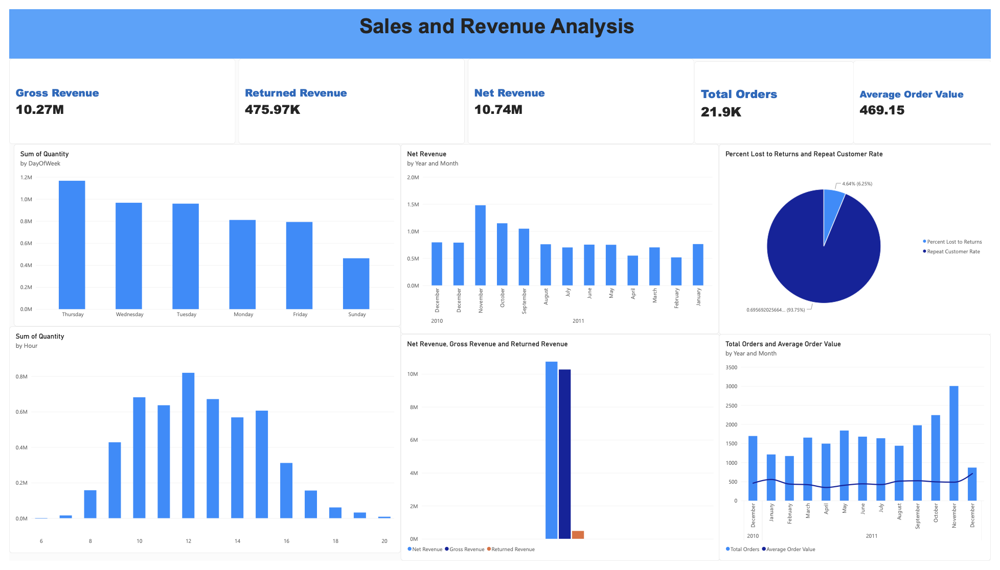

# Know Your Customers, Grow Your Sales
## Enterprise Customer & Retail Transaction Analysis Pipeline

[](https://www.python.org/)
[]()

## Executive Summary

This project analyzes 541,909 retail transactions across 38 countries and provides a reproducible cleaning notebook, analytical datasets, a Power BI dashboard, and client reports.

**Headline results:** cleaned signed net revenue is **£9.79M**; standard sales total **£10.27M**; returns total **£0.476M**; and the UK contributes **85.5%** of absolute transaction value.

### Key Insights & Findings

- **Customer concentration:** Among identified customers (excluding placeholder ID `99999`), the top 10% account for about **62.7%** of identified-customer absolute transaction value.
- **Geographic mix:** The UK contributes about **85.5%** of absolute transaction value. EIRE, the Netherlands, Germany, and France are the next largest markets.
- **Seasonality:** Transaction activity rises in the final quarter, with November the strongest month in the cleaned data.

### Power BI Dashboard

[](dashboard/Ecommerce_analysis.pdf)

[Open the dashboard PDF](dashboard/Ecommerce_analysis.pdf) · [Download the Power BI file](dashboard/Ecommerce_analysis.pbix)

> **Dashboard metric note:** The current dashboard export labels £10.74M as “Net Revenue.” That figure is absolute transaction value; signed net revenue after returns is £9.79M. Reconcile the Power BI measure before using that card in a presentation.

---

## Key Business Questions Answered
1. **Data Trust:** How do we convert unverified raw export files into a trustworthy, standardized database?
2. **Customer Valuation:** Who are our most valuable customers, and what proportion of revenue do they drive?
3. **Geographic Performance:** Which international markets offer the strongest cross-border expansion potential alongside our UK core?
4. **Temporal Trends:** When do peak purchasing surges occur, and how should inventory/marketing budgets adapt?

---

## Project Structure & Processing Workflow

The notebook processes the source data through these stages:

1. **Data Ingestion & Audit:**
   * Loaded raw transaction records (`data.csv`).
   * Identified structural anomalies: 135,080 missing customer IDs, 5,268 duplicate rows, and negative quantities associated with returns or cancellations.
2. **Data Cleaning & Sanitization:**
   * Retained records with missing customer IDs using a placeholder ID, so those transactions remain in aggregate sales analysis.
   * Removed administrative stock codes (e.g., `BANK CHARGES`, `AMAZONFEE`, `POST`, `DOT`) that represent operational costs rather than retail product sales.
   * Removed rows with negative unit prices, as specified in the notebook's cleaning logic.
3. **Outlier Handling:**
   * Winsorized `Quantity` and `UnitPrice` between the 1st and 99th percentiles for the ML feature set, retaining the original fields alongside the capped versions.
4. **Categorical Encoding:**
   * Applied one-hot encoding to the 38 countries represented in the source data.
5. **Feature Engineering:**
   * Calculated signed line revenue as `Revenue = Quantity * UnitPrice`; return rows have negative revenue.
   * Extracted temporal components (Year, Month, Day of Week, Hour) from timestamps.
   * Summarized customer purchasing history and lifetime value in the notebook's analysis.

---

## Getting Started

To run the processing notebook and inspect the pipeline:

1. Clone or download this repository.
2. Follow the environment setup below.
3. Download the [Online Retail dataset](https://www.kaggle.com/datasets/carrie1/ecommerce-data) and save its CSV as `data/raw/data.csv`.
4. Run `notebooks/Ecommerce_analysis.ipynb` in order. It writes the processed datasets under `data/processed/`.

---

## Deliverables
* **Cleaned datasets:** Transaction-level analytical and machine-learning-ready CSV files.
* **Dashboard:** Power BI report and PDF export in `dashboard/`.
* **Client reports:** Brief, proposal, and final report in `reports/`.

## Dataset Overview

The source is the Online Retail dataset available from Kaggle. It contains transactions dated from 1 December 2010 to 9 December 2011 for a UK-based online retailer.

Raw columns:

- `InvoiceNo`: Invoice identifier. Values starting with `C` indicate cancellations.
- `StockCode`: Product code.
- `Description`: Product name.
- `Quantity`: Quantity purchased or returned.
- `InvoiceDate`: Transaction date and time.
- `UnitPrice`: Unit price in sterling.
- `CustomerID`: Customer identifier.
- `Country`: Customer country.

## Project Structure

```text
.
|-- data/
|   |-- raw/
|   |   `-- data.csv
|   `-- processed/
|       |-- online_retail_clean.csv
|       `-- online_retail_clean_ml.csv
|-- notebooks/
|   `-- Ecommerce_analysis.ipynb
|-- dashboard/
|   |-- Ecommerce_analysis.pbix
|   |-- Ecommerce_analysis.pdf
|   `-- dashboard-preview.png
|-- reports/
|   |-- client_brief.pdf
|   |-- client_proposal.pdf
|   `-- final_report.pdf
|-- requirements.txt
|-- .gitignore
`-- README.MD
```

## Environment Setup

Download the dataset from [Kaggle](https://www.kaggle.com/datasets/carrie1/ecommerce-data) and save its CSV as `data/raw/data.csv`. Then create and activate a virtual environment:


```bash
python3 -m venv .venv
source .venv/bin/activate
```

Install dependencies:

```bash
pip install -r requirements.txt
```

Optional: register the environment as a Jupyter kernel:

```bash
python -m ipykernel install --user --name ecommerce-analysis --display-name "Ecommerce Analysis"
```

## How to Run the Project

Start Jupyter:

```bash
jupyter notebook
```

Open and run:

```text
notebooks/Ecommerce_analysis.ipynb
```

The notebook expects the raw file at:

```text
data/raw/data.csv
```

When the notebook is run successfully, it creates or refreshes:

```text
data/processed/online_retail_clean.csv
data/processed/online_retail_clean_ml.csv
```

## Analysis Workflow

1. Data description and initial exploration
2. Missing value, duplicate, and anomaly detection
3. Data cleaning and formatting
4. Feature engineering
5. Business analytics questions
6. Export of cleaned dataset
7. Outlier capping and categorical encoding
8. Export of machine-learning-ready dataset

## Cleaning and Transformation Summary

Main issues found in the raw data:

- `5,268` duplicate rows
- `135,080` missing `CustomerID` values
- `1,454` missing `Description` values
- Negative quantities associated with returns and cancellations
- Negative unit prices associated with adjustments; these rows are removed during cleaning
- `InvoiceDate` stored as text instead of datetime

Main transformations:

- Removed duplicate rows.
- Filled missing `CustomerID` values with a placeholder for unknown customers.
- Filled or mapped missing product descriptions where possible.
- Created `TransactionType` to separate standard sales from returns.
- Removed rows with negative `UnitPrice` values.
- Converted `InvoiceDate` to datetime.
- Created `Revenue = Quantity * UnitPrice`.
- Added time-based features: `YearMonth`, `Hour`, and `DayOfWeek`.
- Removed numeric outliers for ML by clipping `Quantity` and `UnitPrice` to their respective 1st and 99th percentile bounds. Values below the 1st percentile are raised to that lower bound; values above the 99th percentile are reduced to that upper bound. The original columns remain available alongside `Quantity_Capped`, `UnitPrice_Capped`, and signed `Revenue_Capped`.
- Encoded `TransactionType` as a binary feature and one-hot encoded `Country` (dropping one country column as the reference category).

### Machine-Learning-Ready Features

The ML export retains the transaction and time fields, adds capped numeric features (`Quantity_Capped`, `UnitPrice_Capped`, and `Revenue_Capped`), adds `TransactionType_Binary`, and expands `Country` into one-hot columns. These prepared features support downstream modeling such as customer segmentation and customer lifetime value (CLV) analysis. The notebook prepares the features; it does not train or evaluate a segmentation or predictive model.

## Output Files

| File | Rows | Columns | Purpose |
| --- | ---: | ---: | --- |
| `data/raw/data.csv` | 541,909 | 8 | Original transaction data |
| `data/processed/online_retail_clean.csv` | 533,877 | 13 | Cleaned analytics dataset |
| `data/processed/online_retail_clean_ml.csv` | 533,877 | 53 | Machine-learning-ready feature set |

## Key Results

From the cleaned dataset:

- Total cleaned records: `533,877`
- Unique invoices: `25,304`
- Unique customer IDs: `4,364` (includes placeholder ID `99999` for unidentified customers)
- Countries represented: `38`
- Net revenue (including returns): `£9,790,054.58`
- Total transaction value (`sum(abs(Revenue))`, counting returns as positive activity): `£10,741,986.90`
- Final ML dataset missing values: `0` (checked across all 53 columns)

### Standard Sales and Returns

`Revenue` is signed, so return transactions reduce net revenue. For total transaction activity, the absolute value of each row's `Revenue` is summed; this counts returned value as positive activity. The absolute-value metric is calculated for this report and is not a separate column in the processed CSVs.

| Transaction type | Rows | Signed revenue | Absolute transaction value |
| --- | ---: | ---: | ---: |
| Standard sales | 525,207 | £10,266,020.74 | £10,266,020.74 |
| Returns | 8,670 | -£475,966.16 | £475,966.16 |
| **Total** | **533,877** | **£9,790,054.58 net** | **£10,741,986.90** |

Top products by absolute transaction value:

| Rank | Product | Absolute transaction value (£) |
| ---: | --- | ---: |
| 1 | PAPER CRAFT , LITTLE BIRDIE | 336,939.20 |
| 2 | REGENCY CAKESTAND 3 TIER | 183,853.59 |
| 3 | MEDIUM CERAMIC TOP STORAGE JAR | 159,180.56 |
| 4 | WHITE HANGING HEART T-LIGHT HOLDER | 112,861.02 |
| 5 | PARTY BUNTING | 100,646.58 |

Top countries by absolute transaction value:

| Rank | Country | Absolute transaction value (£) |
| ---: | --- | ---: |
| 1 | United Kingdom | 9,180,722.40 |
| 2 | EIRE | 287,626.70 |
| 3 | Netherlands | 284,299.14 |
| 4 | Germany | 210,142.64 |
| 5 | France | 187,095.40 |

## Business Questions Supported

The cleaned dataset can be used to answer questions such as:

- What are the monthly sales and revenue trends?
- Which hours and days generate the highest order activity?
- Which products generate the most revenue?
- Which countries are the strongest markets?
- What is the impact of returns on total revenue?
- Which customers have the highest lifetime value?
- How can the cleaned data be used for future segmentation, prediction, or recommendation models?

## Notes

- The raw CSV may require `ISO-8859-1` encoding when loaded directly with pandas.
- The `reports/` folder is reserved for client-facing deliverables.
- The raw source CSV is expected at `data/raw/data.csv`; processed outputs are written to `data/processed/`.

## Suggested GitHub Topics

Add these topics in the repository’s **About** settings on GitHub:

`python` · `pandas` · `power-bi` · `retail-analytics` · `exploratory-data-analysis`

## Requirements

Main Python packages:

- pandas
- numpy
- matplotlib
- seaborn
- scikit-learn
- ipykernel
- nbconvert
- notebook
